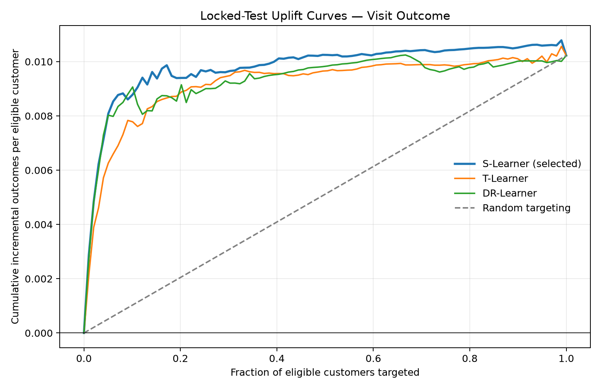
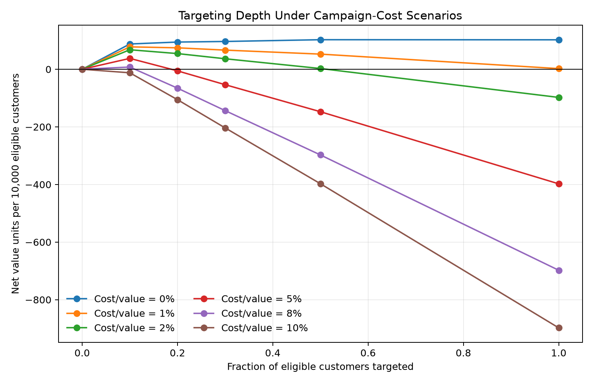

# Customer Campaign Experimentation & Uplift Modeling

An end-to-end causal machine learning project for deciding **whether a campaign creates incremental behavior** and **which customers should be targeted under a limited budget**.

The project uses the corrected Criteo Uplift Prediction Dataset v2.1, built from randomized incrementality tests. It deliberately starts with experiment integrity and treatment-effect estimation before any predictive model is trained.

## Business question

Response models answer: *Who is likely to visit or convert?*

Uplift models answer a more useful targeting question: *Whose behavior will change because of the treatment?*

The planned decision pipeline is:

1. verify that the randomized experiment is credible;
2. estimate average treatment effects with uncertainty;
3. identify heterogeneous treatment effects;
4. compare uplift models fairly using out-of-sample Qini/AUUC;
5. translate uplift rankings into a budget-constrained targeting policy.

## Current status

### Milestone 1 — Data and experiment integrity

- [x] Reproducible project structure and isolated environment
- [x] Official-data download with SHA-256 manifest
- [x] Deterministic, memory-safe analysis sampling
- [x] Data-contract validation
- [x] Treatment/control balance audit
- [x] Descriptive visit and conversion lift with 95% confidence intervals

### Next milestones

- [x] Power and minimum-detectable-effect analysis
- [x] Average treatment effect estimation and robustness checks
- [x] S-learner, T-learner, and doubly robust uplift models
- [x] Honest train/validation/test evaluation with Qini and AUUC
- [x] Budget-constrained targeting policy evaluation
- [x] Campaign cost and profit sensitivity analysis
- [x] Final executive report and reproducible figures

## Repository structure

```text
.
├── data/
│   ├── raw/                 # downloaded source data (not committed)
│   └── processed/           # deterministic analysis sample (not committed)
├── docs/                    # data source, license, and methodology notes
├── reports/
│   ├── figures/             # generated charts (not committed in milestone 1)
│   └── tables/              # generated audit outputs (not committed)
├── scripts/                 # command-line workflow
├── src/uplift_experiment/   # reusable validation and audit code
└── tests/                   # unit tests on synthetic randomized data
```

## Quick start

Python 3.11 or 3.12 is recommended.

```bash
python3 -m venv .venv
source .venv/bin/activate
python -m pip install --upgrade pip
python -m pip install ".[dev]"

python scripts/download_data.py
python scripts/build_analysis_sample.py --sample-rows 1000000
python scripts/run_experiment_audit.py
python scripts/run_ate_analysis.py
python scripts/train_uplift_models.py --outcome visit
python scripts/run_policy_economics.py
pytest
```

The full source file is approximately 297 MB compressed and contains 13,979,592 rows. Neither the raw data nor derived row-level samples are committed to GitHub.

## Milestone 1 results

The seeded one-million-row sample passed the initial experiment-integrity audit:

| Diagnostic | Result |
|---|---:|
| Treatment share | 85.03% |
| Maximum absolute standardized mean difference | 0.0505 |
| Visit risk difference | +1.0216 percentage points |
| Visit 95% CI | [0.9139, 1.1293] percentage points |
| Conversion risk difference | +0.1084 percentage points |
| Conversion 95% CI | [0.0823, 0.1344] percentage points |

These are unadjusted intent-to-treat descriptions, not yet the final causal specification. Machine-readable results are stored in [`reports/tables`](reports/tables).

Average effects are subsequently checked using Lin's fully interacted covariate adjustment with HC1 heteroskedasticity-robust standard errors. Centered pre-treatment features and treatment-by-feature interactions preserve the sample ATE interpretation despite the unequal 85/15 assignment ratio.

| Outcome | Lin-adjusted risk difference | 95% CI | 80%-power MDE |
|---|---:|---:|---:|
| Visit | +0.8067 pp | [0.7111, 0.9022] pp | 0.1511 pp |
| Conversion | +0.0960 pp | [0.0707, 0.1214] pp | 0.0359 pp |

Both adjusted effects remain positive after Holm correction across the two outcomes. The adjusted estimates are smaller than the raw differences, which is why both transparent and covariate-adjusted specifications are reported rather than selecting the more favorable number. See [`docs/methodology.md`](docs/methodology.md) for the estimand, regression specification, power approximation, and interpretation boundaries.

## Uplift model results

Three prespecified learners were trained on 60% of the sample. Selection used only the 20% validation split; the remaining 20% was kept as a locked test set.

| Model | Validation Qini | Locked-test Qini | Locked-test AUUC |
|---|---:|---:|---:|
| **S-Learner (selected)** | **0.004851** | **0.004683** | **0.009796** |
| DR-Learner | 0.004826 | 0.004184 | 0.009297 |
| T-Learner | 0.003257 | 0.004073 | 0.009186 |

The S-Learner narrowly won under the prespecified validation rule; its validation Qini was close to the DR-Learner, so this is not presented as decisive evidence of algorithmic superiority.

On the locked test set, targeting only the top 10% under the selected model produced an estimated **87.7 incremental visits per 10,000 eligible customers**, compared with **102.3 per 10,000** from targeting everyone. In other words, the top decile captured approximately **85.8% of the full-population incremental visits while treating only 10% of customers**.



See [`docs/model_evaluation.md`](docs/model_evaluation.md) for the locked-split protocol, learner definitions, treatment-aware metrics, and interpretation limits.

## Cost-sensitive targeting

The data does not include financial inputs, so the decision analysis avoids invented dollar values. It varies treatment cost as a percentage of the value assigned to one incremental visit.

| Treatment cost / visit value | Optimal tested targeting depth | Net value units per 10,000 eligible |
|---:|---:|---:|
| 0% | 50% | 102.57 |
| 1% | 10% | 77.72 |
| 2% | 10% | 67.72 |
| 5% | 10% | 37.72 |
| 8% | 10% | 7.72 |
| 10% | 0% | 0.00 |



The selected top-decile policy breaks even when treatment cost reaches approximately 8.77% of the value of one incremental visit. See [`docs/decision_analysis.md`](docs/decision_analysis.md) for the equation and interpretation, and [`reports/executive_summary.md`](reports/executive_summary.md) for the complete management summary.

## Reproducibility and guardrails

- The download script records the resolved URL, byte size, timestamp, and SHA-256 digest, and rejects any file that does not match the pinned v2.1 digest.
- The sample is selected by a fixed seed and exact source-row indices, rather than by taking the first rows.
- The data contract rejects unexpected columns, non-binary outcomes, missing values, and malformed treatment assignments.
- Covariate balance is assessed using standardized mean differences; `|SMD| > 0.10` is treated as a material warning, not as an automatic causal verdict.
- `exposure` is a post-treatment variable and is excluded from pre-treatment balance checks and baseline targeting features.

## Data source and license

The dataset is provided by Criteo AI Lab under **CC BY-NC-SA 4.0**. The source data is not included in this repository. See [`docs/data_source_and_license.md`](docs/data_source_and_license.md) for attribution, the corrected-version rationale, and usage restrictions.

Original code and methodology documentation are released under MIT. Aggregate tables, figures, and summaries under [`reports/`](reports/) are shared under CC BY-NC-SA 4.0 with Criteo attribution; see [`reports/LICENSE.md`](reports/LICENSE.md). Neither license replaces or modifies the source dataset terms.
